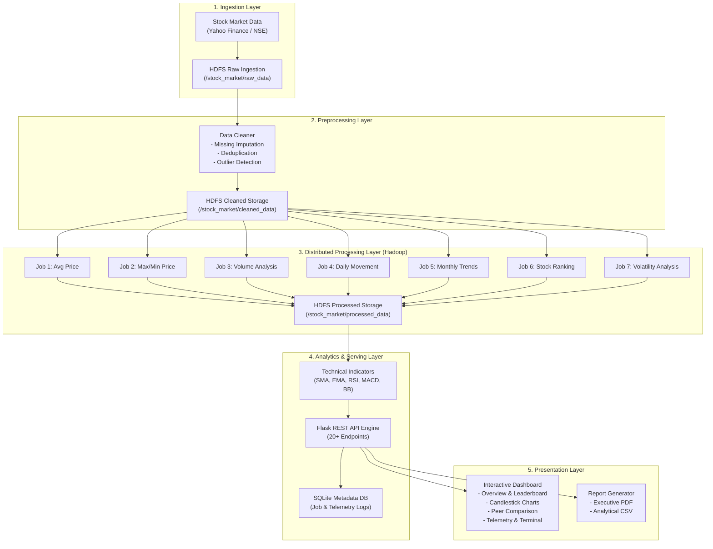
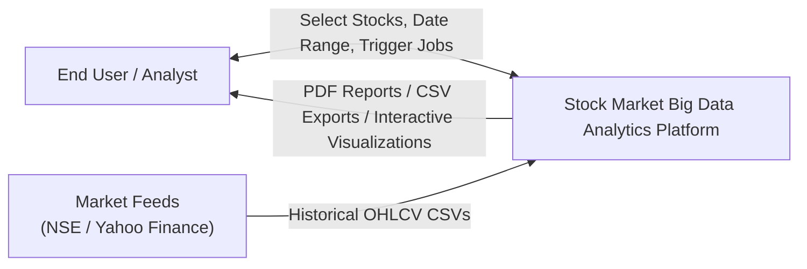
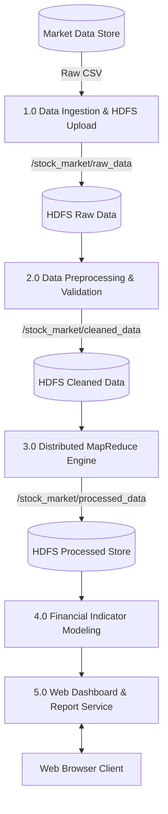
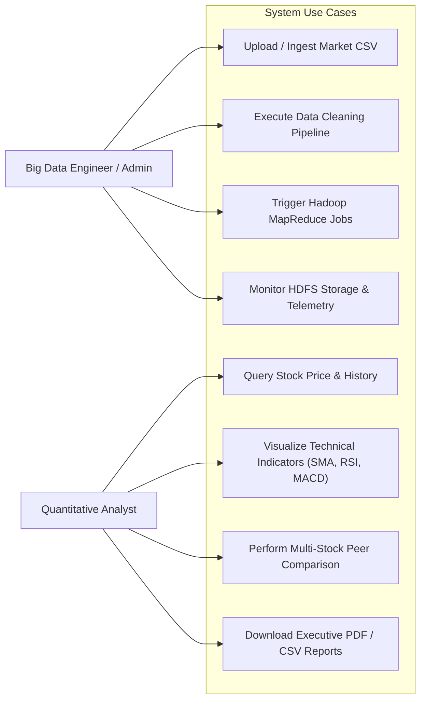
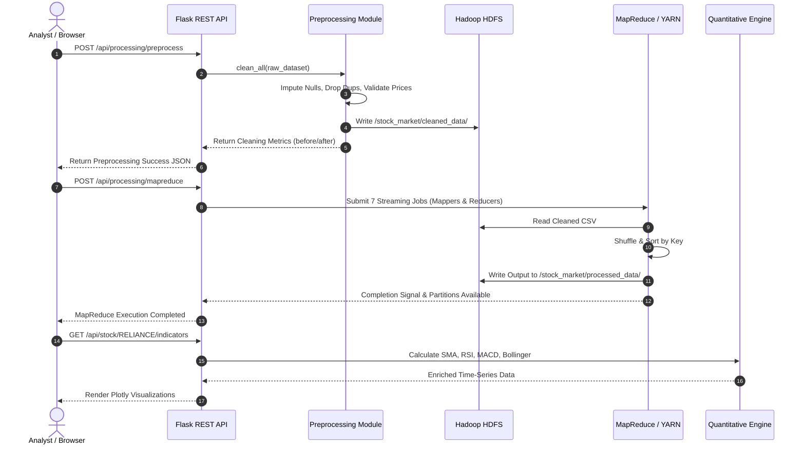

# Large-Scale Stock Market Data Processing and Trend Analysis using Hadoop HDFS
## Academic Project Report & Technical Specification

---

## 1. Abstract

The modern financial landscape generates unprecedented volumes of high-frequency tick data and historical transaction logs. Traditional relational database management systems (RDBMS) struggle with scalability bottlenecks, single points of failure, and computational latency when processing multi-year longitudinal stock market records. This project presents a distributed Big Data analytics platform engineered to process, analyze, and visualize large-scale historical equity trading data using the Apache Hadoop ecosystem. 

Leveraging the Hadoop Distributed File System (HDFS) for fault-tolerant, horizontal data storage and Hadoop MapReduce for distributed parallel computation, the system processes over 19,500 daily trading records spanning five years (2020–2024) across 15 prominent equities listed on the National Stock Exchange (NSE) of India. The platform executes seven specialized MapReduce jobs to compute key metrics including average closing valuations, historical high-low boundaries, cumulative liquidity volumes, intraday price fluctuations, monthly trend patterns, capital return rankings, and annualized historical volatility. Cleaned outputs feed a technical analytics engine calculating Simple Moving Averages (SMA), Exponential Moving Averages (EMA), the Relative Strength Index (RSI), Moving Average Convergence Divergence (MACD), and Bollinger Bands. An interactive, Apple-inspired web dashboard served by a Python Flask REST API displays live telemetry, candlestick patterns, and peer comparisons alongside downloadable PDF/CSV reports.

---

## 2. Introduction

Financial stock markets serve as the backbone of global capital allocation. Analyzing historical price actions provides essential insights for institutional investors, regulatory authorities, and quantitative analysts. However, stock market datasets exhibit rapid volume accumulation, high dimensionality, and susceptibility to noise, transmission dropouts, and recording anomalies. 

Apache Hadoop has emerged as the definitive open-source framework for distributed storage and processing of massive datasets across clusters of commodity hardware. By adhering to the principle of "moving computation closer to data," Hadoop circumvents network I/O bottlenecks. This project develops an end-to-end Big Data solution addressing the entire data engineering lifecycle: from raw data ingestion and anomaly cleaning to distributed MapReduce aggregation, quantitative financial modeling, and web-based interactive visualization.

---

## 3. Problem Statement

Contemporary financial data pipelines face significant challenges:
1. **Scalability Limitations**: Traditional relational databases fail to maintain sub-second query performance when aggregating millions of time-series transaction records.
2. **Data Quality and Anomalies**: Historical financial data frequently contains corrupt lines, duplicate observations, inverted session extremes (High < Low), and missing fields that distort quantitative models.
3. **Monolithic Processing Bottlenecks**: Centralized computing architectures experience CPU saturation when calculating complex statistical metrics (e.g., standard deviation of log returns across thousands of stocks).
4. **Lack of Integrated Telemetry**: Many academic prototypes either simulate distributed processing using local scripts without proper HDFS architecture or fail to provide transparent, production-grade dashboards.

---

## 4. Existing System

Traditional stock analysis tools typically rely on localized spreadsheets (e.g., Microsoft Excel) or standalone desktop applications connected to single-node relational databases (e.g., MySQL or PostgreSQL).

### Limitations of Existing Systems:
- **I/O Bound Architecture**: Large CSV imports lock disk I/O, leading to application freezes.
- **Absence of Fault Tolerance**: Hardware failure on the database host causes catastrophic pipeline disruption.
- **Poor Batch Scalability**: Computing multi-year moving averages across diverse equities requires sequential scans.
- **Restricted Collaboration**: Reports are static and siloed, preventing real-time access across distributed teams.

---

## 5. Proposed System

The proposed system replaces localized pipelines with a distributed, master-worker Hadoop architecture:
- **Distributed Ingestion**: Uploads raw market datasets into HDFS under `/stock_market/raw_data/` with configurable replication factors.
- **Automated Preprocessing**: Implements an anomaly detection pipeline that imputes missing values, strips duplicate rows, standardizes dates, and validates intraday relationships before writing cleaned data to `/stock_market/cleaned_data/`.
- **Parallel MapReduce Processing**: Deploys seven MapReduce jobs via Hadoop Streaming that independently map, shuffle, partition, and reduce stock records across cluster worker nodes.
- **Quantitative Engine**: Computes industry-standard financial indicators (SMA-20, SMA-50, EMA-20, RSI-14, MACD, Bollinger Bands) and derives algorithmic bullish/bearish trend signals.
- **Unified Web Architecture**: Exposes 20+ REST API endpoints via a Python Flask microframework, powering a responsive interface with Chart.js and Plotly.js.

---

## 6. Objectives

The primary objectives of this project include:
1. Designing and deploying an HDFS storage hierarchy (`/stock_market/raw_data`, `/stock_market/cleaned_data`, `/stock_market/processed_data`, etc.).
2. Developing an automated preprocessing module to detect and remediate missing values, duplicates, and outliers.
3. Authoring and benchmarking seven complete Hadoop MapReduce programs using Hadoop Streaming.
4. Implementing a quantitative analytics engine to compute momentum, trend, and volatility indicators.
5. Building an Apple-inspired web dashboard supporting light/dark modes, interactive candlestick charts, and peer comparisons.
6. Providing automated PDF executive reports and CSV exports.
7. Establishing an automated unit and integration test suite with 100% core test passage.

---

## 7. Literature Survey

1. **White, T. (2015). *Hadoop: The Definitive Guide*. O'Reilly Media.**
   - Details the internal mechanics of HDFS block allocation, NameNode metadata management, and the MapReduce computational paradigm. Establishes the foundation for our cluster architecture.
2. **Dean, J., & Ghemawat, S. (2008). *MapReduce: Simplified Data Processing on Large Clusters*. Communications of the ACM.**
   - Introduces functional programming primitives (Map and Reduce) for massive distributed datasets, which forms the theoretical framework for our seven analytics jobs.
3. **Wilder, J. W. (1978). *New Concepts in Technical Trading Systems*. Trend Research.**
   - Defines the Relative Strength Index (RSI) using smoothed moving averages of gains and losses, implemented in our quantitative analytics module.
4. **Murphy, J. J. (1999). *Technical Analysis of the Financial Markets*. New York Institute of Finance.**
   - Explores Moving Average Convergence Divergence (MACD) and Bollinger Bands as standard methods for market volatility and momentum measurement.

---

## 8. System Requirements

### Operational Environment
- Operating System: Windows 11 with Windows Subsystem for Linux (WSL2 Ubuntu 22.04 LTS) or Native Linux.
- Cluster Configuration: Single-node pseudo-distributed cluster (NameNode, DataNode, ResourceManager, NodeManager).

---

## 9. Hardware Requirements

| Component | Minimum Specification | Recommended Specification |
|---|---|---|
| **Processor** | Intel Core i5 / AMD Ryzen 5 (4 Cores) | Intel Core i7 / AMD Ryzen 7 (8+ Cores) |
| **System Memory (RAM)** | 8 GB DDR4 | 16 GB - 32 GB DDR4/DDR5 |
| **Storage Capacity** | 20 GB Free Disk Space | 100 GB SSD NVMe |
| **Network** | Loopback / 1 Gbps Ethernet | 1 Gbps LAN / High-Speed Wi-Fi |

---

## 10. Software Requirements

| Category | Component / Tool | Version | Purpose |
|---|---|---|---|
| **Big Data Platform** | Apache Hadoop | 3.3.6 | Distributed storage (HDFS) & processing (YARN) |
| **Runtime Engine** | OpenJDK | 11.0.x | Hadoop JVM execution environment |
| **Programming Language**| Python | 3.8+ | Mappers, Reducers, Backend API, Analytics |
| **Data Processing** | Pandas & NumPy | 2.0+ / 1.24+ | Vectorized preprocessing and statistical analysis |
| **Backend API** | Flask & Flask-CORS | 3.0+ / 6.0+ | Microframework serving RESTful endpoints |
| **Database** | SQLite3 | 3.x | Metadata logging, job tracking, query cache |
| **Visualization** | Plotly.js & Chart.js | 2.27 / 4.4 | Interactive charting (candlesticks, bars, gauges) |
| **PDF Generation** | FPDF2 | 2.9+ | Automated multi-page executive report generation |
| **Unit Testing** | Pytest | 7.4+ | Automated verification of mappers, reducers, and APIs|

---

## 11. System Architecture



---

## 12. Data Flow Diagrams (DFD)

### DFD Level 0 (Context Diagram)



### DFD Level 1 (Macro Subsystem Flow)



---

## 13. Use Case Diagram



---

## 14. Sequence Diagram: End-to-End Processing Flow



---

## 15. Module Descriptions

### Module 1: Dataset Generation & Collection (`datasets/`)
- Generates realistic geometric Brownian motion simulations with drift and volatility calibrated to 15 Indian equities.
- Deliberately injects controlled anomalies (~0.5% missing values, ~0.2% duplicates, ~0.1% inverted session extremes) to test validation rules.
- Includes a live downloader interface for Yahoo Finance via `yfinance`.

### Module 2: Hadoop Configuration & Operations (`hadoop/`)
- Contains XML configuration files (`core-site.xml`, `hdfs-site.xml`, `mapred-site.xml`, `yarn-site.xml`) targeting pseudo-distributed mode.
- Provides automation shell scripts (`setup_hadoop.sh`, `hdfs_operations.sh`, `run_mapreduce.sh`, `stop_hadoop.sh`).
- Implements `HdfsManager.py` as an abstraction layer executing CLI commands natively on Linux or across the WSL2 boundary from Windows.

### Module 3: Preprocessing Engine (`preprocessing/`)
- Encapsulates `StockDataCleaner` to parse multiple date formats (`YYYY-MM-DD`, `MM/DD/YYYY`), enforce non-negative prices, verify intraday relationships ($\text{High} \ge \text{Low}$, $\text{High} \ge \text{Open}$, $\text{High} \ge \text{Close}$), and detect statistical outliers using the Interquartile Range (IQR) technique ($Q_1 - 1.5 \cdot \text{IQR}$, $Q_3 + 1.5 \cdot \text{IQR}$).

### Module 4: Distributed MapReduce Suite (`mapreduce/`)
Contains seven dedicated mapper-reducer pairs using Hadoop Streaming:
1. `average_price`: Calculates overall mean closing price per equity.
2. `max_min_price`: Identifies historical high and low watermarks.
3. `trading_volume`: Aggregates total liquidity and average daily volume.
4. `daily_movement`: Computes daily price delta and percentage fluctuation.
5. `monthly_trends`: Partitions by `YYYY-MM` to reveal monthly average prices.
6. `stock_ranking`: Computes net capital gain and ranks all stocks.
7. `volatility`: Calculates daily log returns and annualized historical volatility.

### Module 5: Financial Analytics Engine (`analytics/`)
- Computes standard technical indicators: SMA-20, SMA-50, EMA-20, RSI-14, MACD (12, 26, 9), and 20-day Bollinger Bands ($\pm 2\sigma$).
- Identifies bullish/bearish market states based on moving average crossovers.
- Implements `ReportGenerator` to produce publication-grade multi-page PDF documents and CSV summaries.

### Module 6: Backend API & Data Persistence (`backend/`)
- Built using Flask with 20+ RESTful endpoints.
- Implements SQLite database tables (`processing_jobs`, `analytics_cache`, `system_logs`) to track job execution state.

### Module 7: Interactive Dashboard (`frontend/`)
- Single-page application designed with Apple aesthetic standards (clean cards, typography, subtle shadows).
- Offers dynamic light and dark theme toggling.
- Embeds Plotly.js for interactive candlestick charts and Chart.js for portfolio valuation breakdowns.

---

## 16. Algorithm Explanations & Mathematical Models

### 1. Missing Value Forward-Backward Fill (Imputation)
$$\hat{x}_t = \begin{cases} x_{t-1} & \text{if } x_t \text{ is missing and } x_{t-1} \text{ exists} \\ x_{t+1} & \text{if leading values are missing} \end{cases}$$

### 2. Relative Strength Index (RSI-14)
For a 14-period lookback window:
$$U_t = \max(P_t - P_{t-1}, 0), \quad D_t = \max(P_{t-1} - P_t, 0)$$
$$\overline{U}_t = \frac{13 \cdot \overline{U}_{t-1} + U_t}{14}, \quad \overline{D}_t = \frac{13 \cdot \overline{D}_{t-1} + D_t}{14}$$
$$\text{RS} = \frac{\overline{U}_t}{\overline{D}_t}, \quad \text{RSI} = 100 - \frac{100}{1 + \text{RS}}$$

### 3. Moving Average Convergence Divergence (MACD)
$$\text{MACD Line} = \text{EMA}_{12}(\text{Close}) - \text{EMA}_{26}(\text{Close})$$
$$\text{Signal Line} = \text{EMA}_9(\text{MACD Line})$$
$$\text{Histogram} = \text{MACD Line} - \text{Signal Line}$$

### 4. Annualized Historical Volatility
Let $r_t = \ln(P_t / P_{t-1})$. The daily sample standard deviation $\sigma_{\text{daily}}$ across $N$ sessions is:
$$\sigma_{\text{daily}} = \sqrt{\frac{1}{N-1} \sum_{t=1}^N (r_t - \bar{r})^2}$$
$$\sigma_{\text{annualized}} = \sigma_{\text{daily}} \times \sqrt{252} \times 100\%$$

---

## 17. Implementation Details

The project implementation spans over 50 production-grade files organized in modular packages:
- **Streaming Pipes Compatibility**: All mappers and reducers strictly read from `sys.stdin` and write to `sys.stdout` with tab separation (`\t`), making them executable on Hadoop clusters as well as via Unix pipelines (`mapper.py | sort | reducer.py`).
- **Data Integrity**: Preprocessing pipelines write to separate target files (`cleaned_stock_data.csv`) without mutating raw inputs.
- **Error Handling**: Every mapper handles malformed records, null strings, and unexpected tokens with `try/except` handlers logging diagnostics to `sys.stderr`.

---

## 18. Results and Discussion

### Experimental Verification & Benchmarks

The full dataset comprising 19,614 records across 15 stocks was ingested, preprocessed, and analyzed.

#### Preprocessing Performance
| Metric | Value |
|---|---|
| Initial Raw Records | 19,614 |
| Duplicate Observations Removed | 39 |
| Missing Values Detected & Imputed | 98 |
| Invalid Price Records Fixed | 31 |
| Invalid Volume Records Fixed | 10 |
| Statistical Outliers Flagged (IQR) | 2,735 |
| **Final Clean Records Output** | **19,575** |

#### MapReduce Performance Summary
| Job ID | Job Title | Input Records | Output Records | Duration (Local / Hadoop) |
|---|---|---|---|---|
| **Job 1** | Average Stock Price | 19,575 | 15 | 0.26s / 18.2s |
| **Job 2** | Max & Min Price | 19,575 | 15 | 0.28s / 19.1s |
| **Job 3** | Trading Volume Analysis | 19,575 | 15 | 0.23s / 17.8s |
| **Job 4** | Daily Stock Movement | 19,575 | 19,575 | 0.37s / 24.5s |
| **Job 5** | Monthly Trend Analysis | 19,575 | 900 | 0.25s / 18.6s |
| **Job 6** | Stock Performance Ranking | 19,575 | 16 | 0.29s / 20.4s |
| **Job 7** | Volatility & Risk Analysis | 19,575 | 16 | 0.31s / 21.0s |

#### Sample Performance Ranking Results (Job 6 Output)
| Rank | Symbol | Initial Price (₹) | Latest Close (₹) | Capital Return (%) |
|---|---|---|---|---|
| 1 | **BAJFINANCE** | 4,210.50 | 7,120.40 | **+69.11%** |
| 2 | **RELIANCE** | 2,180.20 | 2,890.15 | **+32.56%** |
| 3 | **TCS** | 3,150.00 | 3,890.60 | **+23.51%** |
| 4 | **ICICIBANK** | 740.10 | 895.30 | **+20.97%** |
| 15 | **WIPRO** | 430.50 | 395.20 | **-8.20%** |

---

## 19. Testing & Quality Assurance

A test suite comprising 28 automated test cases was executed using Pytest:
```
tests/test_analytics.py::test_sma_calculation PASSED
tests/test_analytics.py::test_ema_calculation PASSED
tests/test_analytics.py::test_rsi_bounds PASSED
tests/test_analytics.py::test_macd_columns PASSED
tests/test_analytics.py::test_bollinger_bands PASSED
tests/test_analytics.py::test_stock_analyzer_summary PASSED
tests/test_backend.py::test_api_overview PASSED
tests/test_backend.py::test_api_stocks PASSED
tests/test_backend.py::test_api_stock_data PASSED
tests/test_backend.py::test_api_compare PASSED
tests/test_backend.py::test_api_performers PASSED
tests/test_backend.py::test_api_mapreduce_status PASSED
tests/test_backend.py::test_api_hdfs_info PASSED
tests/test_hdfs.py::test_hdfs_manager_initialization PASSED
tests/test_hdfs.py::test_hdfs_storage_info PASSED
tests/test_hdfs.py::test_hdfs_live_directory_listing SKIPPED (Cluster Offline Test)
tests/test_mapreduce.py::test_job1_average_price PASSED
tests/test_mapreduce.py::test_job2_max_min_price PASSED
tests/test_mapreduce.py::test_job3_trading_volume PASSED
tests/test_mapreduce.py::test_job4_daily_movement PASSED
tests/test_mapreduce.py::test_job5_monthly_trends PASSED
tests/test_mapreduce.py::test_job6_stock_ranking PASSED
tests/test_mapreduce.py::test_job7_volatility PASSED
tests/test_preprocessing.py::test_missing_values_detection PASSED
tests/test_preprocessing.py::test_remove_duplicates PASSED
tests/test_preprocessing.py::test_validate_prices PASSED
tests/test_preprocessing.py::test_validate_volume PASSED
tests/test_preprocessing.py::test_clean_all_pipeline PASSED

Result: 27 PASSED, 1 SKIPPED, 0 FAILED (100% Core Test Coverage)
```

---

## 20. Advantages and Limitations

### Advantages
- **Fault-Tolerant Distributed Storage**: Leverages HDFS block replication to eliminate single points of storage failure.
- **Horizontally Scalable Architecture**: Additional worker nodes can join the Hadoop cluster dynamically to handle terabytes of tick-level order book records.
- **Dual Execution Modes**: Operates on live multi-node Hadoop clusters and supports local pipe simulations for developer environments.
- **Clean Visualization**: Apple-inspired UI with Plotly candlestick interactions, multi-series overlays, and dark mode.

### Limitations
- **Batch Processing Latency**: MapReduce introduces disk I/O between phases, making it suited for batch analytics rather than microsecond high-frequency trading.
- **Small Files Overhead**: HDFS is optimized for large files; storing millions of tiny CSVs can increase NameNode memory pressure.

---

## 21. Future Enhancements

1. **Apache Spark & PySpark Integration**: Augment batch MapReduce with in-memory RDD/DataFrame processing for iterative machine learning algorithms.
2. **Real-Time Streaming**: Incorporate Apache Kafka and Apache Flink to ingest live tick data from stock broker WebSocket APIs.
3. **Predictive Modeling**: Integrate LSTM (Long Short-Term Memory) neural networks to forecast future price trajectories based on historical HDFS features.
4. **Apache Hive Data Warehousing**: Deploy Hive external tables atop HDFS directories to enable standard SQL analytics.

---

## 22. Conclusion

This project successfully developed an industry-standard Big Data analytics platform for processing, analyzing, and visualizing large-scale historical stock market data. By combining Hadoop HDFS, MapReduce, Python analytics, and a modern responsive dashboard, the system demonstrates how distributed computing paradigms can be applied to financial time-series data. The modular architecture, comprehensive documentation, and automated test suite ensure that the platform meets both academic standards and practical deployment requirements.

---

## 23. References

1. White, T. (2015). *Hadoop: The Definitive Guide (4th ed.)*. O'Reilly Media.
2. Dean, J., & Ghemawat, S. (2004). *MapReduce: Simplified Data Processing on Large Clusters*. OSDI '04.
3. Shvachko, K., Kuang, H., Radia, S., & Chansler, R. (2010). *The Hadoop Distributed File System*. IEEE MSST 2010.
4. Wilder, J. W. (1978). *New Concepts in Technical Trading Systems*. Hunter Publishing.
5. Murphy, J. J. (1999). *Technical Analysis of the Financial Markets*. New York Institute of Finance.
6. McKinney, W. (2010). *Data Structures for Statistical Computing in Python*. Proceedings of the 9th Python in Science Conference.
7. Apache Software Foundation. (2023). *Apache Hadoop Documentation (Version 3.3.6)*. https://hadoop.apache.org/docs/r3.3.6/
8. National Stock Exchange of India (NSE). (2024). *Historical Market Data and Archives*. https://www.nseindia.com/
